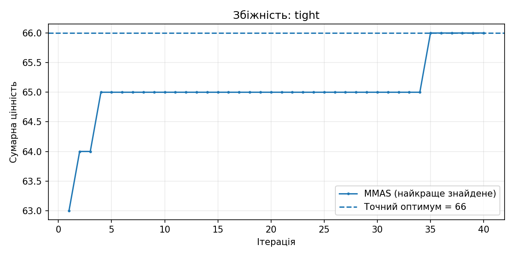
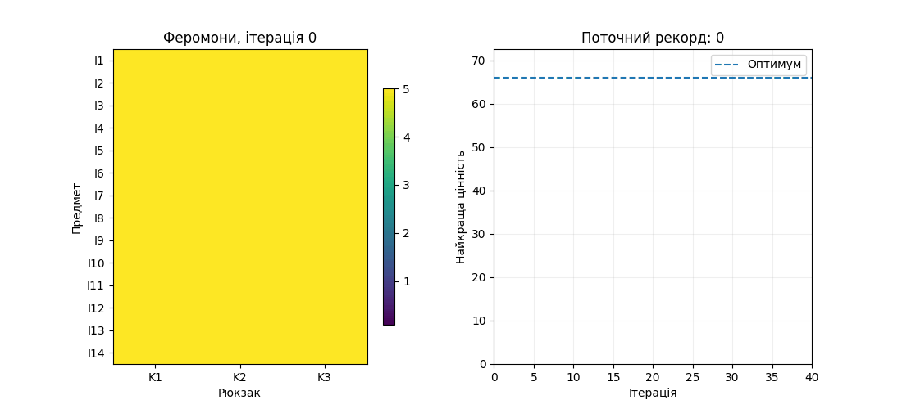

# Лабораторна №1 — Multiple Knapsack + MMAS

Реалізація комбінаторної задачі **Multiple Knapsack Problem** із використанням **Max–Min Ant System (MMAS)** на Python.

## Швидкий старт

Потрібен Python 3.10+ та пакетний менеджер `uv`.

```bash
uv sync --all
uv run main.py --mode all
```

Окремі режими:

```bash
uv run main.py --mode tests        # перевірка допустимості та точних оптимумів
uv run main.py --mode demo         # візуалізація одного запуску
uv run main.py --mode experiment   # 168 запусків з різними параметрами
```

Для зміни зерна генератора випадкових чисел у демо:

```bash
uv run main.py --mode demo --seed 42
```

## Структура

- `main.py` - алгоритм MMAS, приклади, точний еталонний розв'язувач, графіки, експерименти.
- `outputs/` - графіки `01`–`04`, анімація `05`, детальний CSV `06`, підсумкова таблиця `07`.
- `pyproject.toml` - файл залежностей проєкту

## Параметри за замовчуванням

16 мурах, 40 ітерацій, alpha = 1, beta = 2, rho = 0.2, tau_min = 0.1, tau_max = 5, fill_penalty = 0.5.

В алгоритмі використано матрицю феромонів **предмет × рюкзак**, лише допустимі дії та правило оновлення лише за найкращою мурахою ітерації з фіксованими межами феромону. Це **спрощена адаптація MMAS**, а не готовий бібліотечний оптимізатор.

## Відтворюваність

Точні значення для тестових прикладів обчислюються незалежною функцією `exact_optimum`, заснованою на динамічному програмуванні. В експерименті використано `seed = 0..7` для кожного набору параметрів. За однакових вихідних даних і параметрів результати повторювані.

## Зображення



